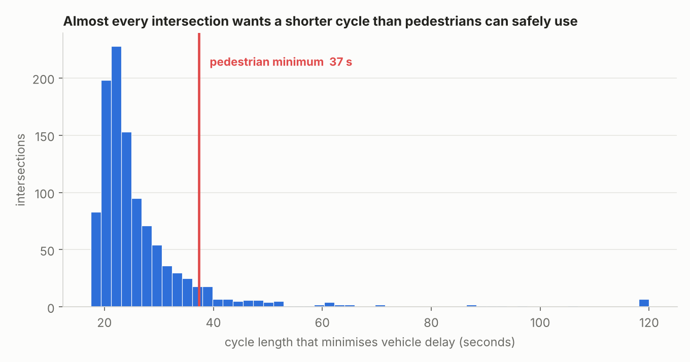
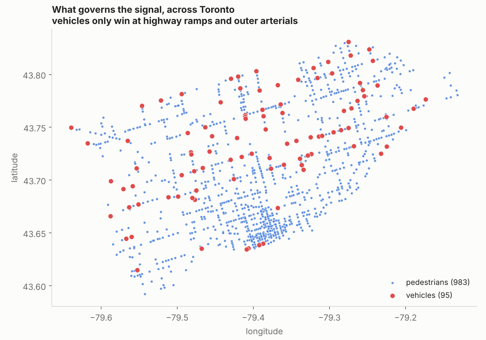
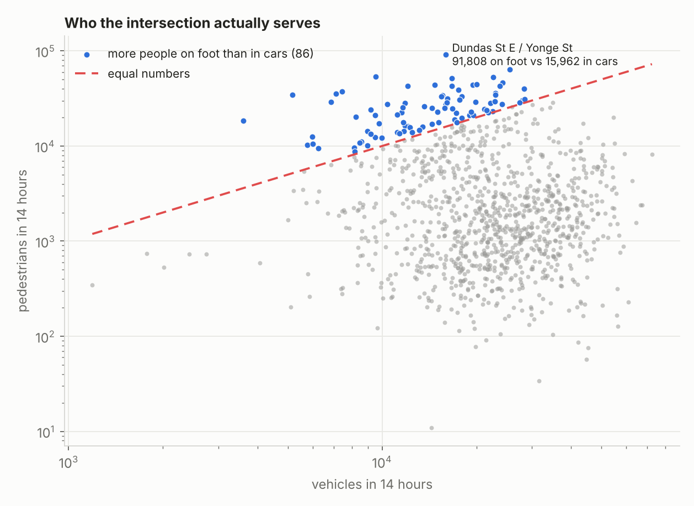
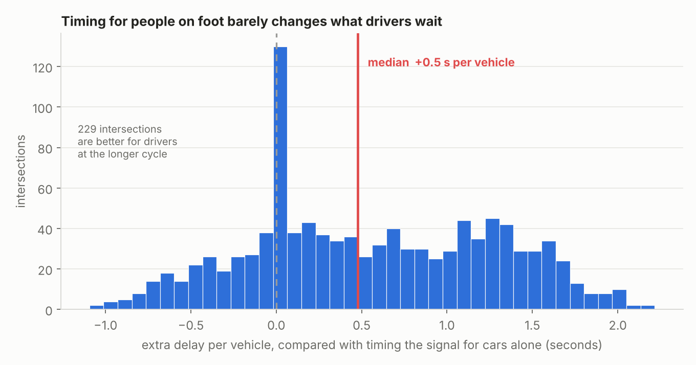

# Who really sets the timing of Toronto's traffic signals?

I ran Webster's signal timing method on 1,078 signalised intersections in
Toronto, using the City's open turning movement counts. I expected the traffic
volumes to decide the answer. They mostly don't.

> At 91% of these intersections, the cycle length that gives cars the least
> delay is shorter than the time people need to walk across. So pedestrians,
> not traffic, decide the timing. Vehicles win at only 95 intersections, mostly
> highway ramps and outer arterials.



## Why I did this

A signal splits its time between directions. Webster (1958) worked out the
cycle length that keeps total vehicle delay lowest for a given set of volumes.
Textbooks run it on one intersection. I wanted to see what it says when you run
it on a whole city's worth of real counts, and what gets in the way of using
the answer.

## Where each one wins



The 95 vehicle-governed intersections aren't scattered at random. They're
Highway 401 collectors, the Gardiner, and wide suburban arterials: lots of
cars, hardly anyone walking. The model never knew what kind of road it was
looking at, so I take this as a good sign that it's behaving sensibly.

Counting trucks properly moved 18 intersections out of the pedestrian group and
into this one. They are the places you would guess. McCowan at Nugget, Finch
West at Humberline, Weston at Steeles, Ellesmere at Midland: industrial
Scarborough and Etobicoke, and the arterials feeding the 401. Heavy vehicles
make up 5.1% of peak traffic at those 18 sites against 3.9% everywhere else.

## Who the intersection is for



The City counts pedestrians as well as vehicles, and I'd guess most people
ignore that column. At 86 of the 1,078 intersections, more people cross on foot
than pass through in vehicles. Dundas and Yonge is the extreme: 91,808 people
on foot in 14 hours against 15,962 vehicles, about six to one.

The usual tools (Webster, the Highway Capacity Manual delay model, TRANSYT,
SCOOT) mostly optimise vehicle delay and treat pedestrians as a minimum time
to be satisfied. At these 86 places that minimum ends up being most of what the
signal does.

## What it costs drivers



Webster gives you a cycle length but says nothing about whether the result is
any good, so I added the Highway Capacity Manual's control delay and its A-to-F
grade. The median driver waits 6.8 seconds and 98.6% of these intersections
come out at grade A or B. Capacity isn't what's tight here.

So what does the pedestrian minimum cost drivers? I timed each intersection
twice, once at the cycle it ends up with and once at the cycle that suits
vehicles alone, and took the difference. The median is 0.5 seconds per vehicle
and the worst case is 2.2 seconds. Over the whole morning peak hour, across all
1,078 intersections and about two million vehicles, it adds up to roughly 250
vehicle-hours.

At 229 of them the longer cycle is actually *better* for drivers. Lost time is
8 seconds per cycle whatever the cycle length, so it eats 40% of a 20-second
cycle and only 21% of a 37-second one. Webster's formula and the HCM delay
model disagree at these low volumes, and where they do, the pedestrian
minimum happens to land on the better side.

Every one of the bad sites is vehicle-governed. Highway 401 collector ramps,
Ellesmere at Kennedy, Lawrence at Railside, the Gardiner ramp at Spadina. The
one grade F is a 401 collector ramp at Leslie, where `Y` is high enough to push
the cycle past six minutes.

## How it works

1. **Passenger car equivalents.** A truck or bus counts as two cars, since it
   takes longer to clear the stop line. Heavy vehicles are 4% of peak traffic
   at the median intersection and 36% at the worst one.
2. **Critical movement.** In each phase the busiest approach sets the green.
   The green has to clear the worst queue, not the average one.
3. **Flow ratio**, `y = volume / (lanes x 1900)`. It's the share of the hour
   that movement needs green.
4. **Y** is the sum of the critical `y` across phases. If `Y >= 1`, more cars
   arrive than the signal can clear and no timing helps.
5. **Webster cycle**, `C = (1.5L + 5) / (1 - Y)`, where `L` is lost time at
   4 seconds per phase.
6. **Pedestrian minimum**, using Toronto's own Type A rule: at least 7 s of
   WALK, a flashing hand long enough to cross at 1.2 m/s, and the two together
   averaging 1.0 m/s over the full width. Summed over the phases.
7. **Final cycle** is the longer of 5 and 6.
8. **Delay and grade**: HCM control delay per approach at that cycle, weighted
   by volume, then the A-to-F band it falls in.

Nothing is fitted or trained here. It's an existing formula applied to real
counts.

### Where the constants come from

| Constant | Value | Source |
|---|---|---|
| Saturation flow | 1,900 pc/h/ln | HCM base rate. Canadian field values run 1,700-1,900 |
| Lost time | 4 s per phase | 2 s start-up + 2 s clearance, the standard HCM split |
| Minimum WALK | 7 s | City of Toronto pedestrian timing guidelines, Type A |
| Flashing hand speed | 1.2 m/s | Same, Type A |
| Overall walk speed | 1.0 m/s | Same. Toronto dropped it from 1.2 m/s in 2018 |
| Truck and bus factor | 2.0 pcu | Canadian Capacity Guide, combined approximation |

I had used 1.07 m/s for walking, which is the US MUTCD's 3.5 ft/s. Toronto
doesn't use that figure, so the pedestrian minimum at a 14 m crossing came out
at 40.2 s instead of the 37.3 s the city's own rule gives. Switching to the
Toronto rule moved the headline from 94% to 91%. Twenty minutes of checking
changed the answer more than any of the modelling did.

## Data

City of Toronto, Transportation Services Division, *Traffic Volumes -
Multimodal Intersection Turning Movement Counts*. Open Government Licence -
Toronto, refreshed daily:
<https://open.toronto.ca/dataset/traffic-volumes-at-intersections-for-all-modes/>

The counts come from video, grouped into 15-minute slices, and the programme
goes back to 1984.

| File | One row is | I use it for |
|---|---|---|
| `tmc_most_recent_summary_data.csv` | an intersection | choosing sites, finding the peak hour |
| `tmc_raw_data_2020_2029.csv` | a 15-minute slice | turning movements and pedestrians |

### Which intersections made it in

| Step | Left |
|---|---|
| intersections in the file | 6,405 |
| signalised only (`px` present) | 2,661 |
| 14-hour continuous counts only | 1,411 |
| traffic on all four legs | **1,078** |

Webster is for signals, so unsignalised intersections are out. Counts before
September 2023 covered 8 hours that weren't continuous; the newer ones cover 14
continuous hours, so I only used the newer ones. Three-leg and irregular
junctions need different phasing, so I left them for later.

The counts I used are dated September 2023 to October 2026 (median July 2025),
over an area about 41 km east-west and 27 km north-south.

## Running it

```bash
pip install -r requirements.txt
# put the two CSVs from the link above into data/raw/
python src/build_dataset.py   # 6,405 intersections down to 1,078, with peak movements
python src/webster.py         # runs the built-in tests
python src/analyse.py         # cycle length for every intersection
python src/figures.py         # the four charts above
```

`build_dataset.py` works out each peak hour again from the raw 15-minute rows
and compares it with the peak count in the summary file. All 2,156 rows match.
`webster.py` has ten doctests, one for each formula.

## What's weak about it

- **Lanes are assumed.** I used 2 per approach because the data doesn't say.
  `Y` goes down as lanes go up, so individual intersections will shift. Real
  lane counts from OpenStreetMap are the first thing I want to add.
- **Crossing distance is assumed** at 14 m. The main result holds across a
  sensible range (pedestrians govern at 78% of intersections with 9 m and 96%
  with 20 m) but the exact percentage depends on it.
- **Two phases only.** Where left turns are heavy you'd want protected phases,
  which add lost time and lengthen the cycle. Left turns average 12% of peak
  traffic here and go up to 41%.
- **Saturation flow is the ideal figure, not a Toronto one.** 1,900 pc/h/ln is
  the HCM base rate. Field work behind the Canadian Capacity Guide found 1,700
  to 1,900 across nine Canadian districts, with downtown lanes running about 7%
  below suburban ones. So capacity is probably flattered downtown, which would
  push a few more intersections into the vehicle-governed group.
- **One truck factor for every heavy vehicle.** The Canadian Capacity Guide
  gives 1.5 for single-unit trucks, 2.5 for multi-unit, 1.75 for buses and
  streetcars, and says 2.0 is a fair combined approximation when the counts
  don't separate them. Toronto's don't, so 2.0 is the right call here, but a
  streetcar route and a container route get the same weight.
- **Webster assumes an isolated intersection that isn't overloaded.** It
  ignores neighbouring signals and says nothing useful once `Y >= 1`.
- **The delay figures assume random arrivals.** I set the HCM progression
  factor to 1, which treats every signal as if nothing upstream is feeding it
  platoons. On a coordinated arterial that is wrong, and it is wrong in the
  direction of overstating delay.
- **This isn't a random sample of Toronto's signals.** The City says counts are
  *"collected on an ad-hoc, as needed basis, therefore does not have
  comprehensive temporal or geographic coverage"*, and that some over- and
  under-counting may remain. So the results describe these 1,078 intersections,
  not every signal in the city.

## References

- Webster, F.V. (1958). *Traffic Signal Settings*. Road Research Technical
  Paper No. 39. Road Research Laboratory, London.
- City of Toronto (2020). *Pedestrian Timing at Signalised Intersections*.
  Traffic Systems Operations.
  <https://www.toronto.ca/wp-content/uploads/2020/08/945f-TS_Traffic-Management_Pedestrian-Timing-Guidelines-2020.pdf>
- City of Toronto (2015). *Traffic Signal Operations Policies and Strategies*.
  <https://www.toronto.ca/wp-content/uploads/2017/11/91d6-0_2015-11-13_Traffic-Signal-Operations-Policies-and-Strategies_Final-a.pdf>
- Canadian Institute of Transportation Engineers. *Canadian Capacity Guide for
  Signalized Intersections*, 3rd ed.
- Transportation Research Board. *Highway Capacity Manual*, for the control
  delay equation, the level of service bands and the 1,900 pc/h/ln base rate.
- Ontario Ministry of Transportation. *Ontario Traffic Manual Book 12: Traffic
  Signals*, and *Book 15: Pedestrian Crossing Facilities*.

## Licence

Code is MIT (see `LICENSE`). The data is under the Open Government Licence -
Toronto.
